<div align="center">

<picture>
  <source media="(prefers-color-scheme: dark)" srcset=".github/assets/banner-dark.svg">
  
</picture>

**Retained-mode 2D graphics built for native frame budgets.**<br>
Compose drawing surfaces, paths, paints and interactions without shipping a WebView or replaying a PHP scene every frame.

[](https://packagist.org/packages/pushinbr/pam-native-canvas)
[](https://github.com/push-in/pam-native-canvas/releases/latest)

[](https://github.com/push-in/pam-native-canvas/actions/workflows/ci.yml)
[](LICENSE)

[Install](#install) · [Quick example](#quick-example) · [Platforms](#platform-support) · [Reference](docs/commands.md) · [Docs](#docs) · [Issues](https://github.com/push-in/pam-native-canvas/issues)

</div>

<a id="install"></a>
## <picture></picture> Install

Inside a PAM Native project, add only this capability:

```sh
pam composer require pushinbr/pam-native-canvas
pam doctor --fix
```

New to PAM? Create a project with `pam init my-app --template native` (see the [PAM Native overview](https://push-in.github.io/pam-docs/native/overview/)), then come back here. Composer owns the manifest and the lockfile; `pam composer` runs it on PAM's verified PHP runtime.

<a id="quick-example"></a>
## <picture></picture> Quick example

A line chart with a gradient area, a 2dp curve, a dashed baseline and aligned labels:

```php
use Pam\Native\Canvas\Canvas;
use Pam\Native\Canvas\CanvasView;
use Pam\Native\Canvas\FontWeight;
use Pam\Native\Canvas\Path;
use Pam\Native\Canvas\PathMode;
use Pam\Native\Canvas\TextAlign;

$line = Path::start(0, 120)
    ->curveTo(40, 120, 60, 40, 100, 40)
    ->curveTo(140, 40, 160, 90, 200, 90)
    ->curveTo(240, 90, 260, 20, 300, 20);

$area = $line->lineTo(300, 160)->lineTo(0, 160)->close();

$scene = (new Canvas())
    ->dashedLine(0, 160, 300, 160, '#2c3947', 1, 4, 4)
    ->save()
        ->alpha(0.35)
        ->gradientPath($area, 0, 20, 0, 160, '#19c5ff', '#19c5ff00')
    ->restore()
    ->path($line, '#19c5ff', 2, PathMode::Stroke)
    ->circle(300, 20, 4, '#19c5ff')
    ->label('$1,234', 300, 10, 12, '#f4f7fa', TextAlign::Right, FontWeight::SemiBold)
    ->label('Mon', 0, 178, 11, '#a0adbb')
    ->label('Fri', 300, 178, 11, '#a0adbb', TextAlign::Right)
    ->scene();

return CanvasView::make($scene, revision: 1)->dp();
```

PHP builds a bounded display list; Android Canvas and Core Graphics render it without calling PHP for each frame.

<a id="platform-support"></a>
## <picture></picture> Platform support

| Platform | Support | Notes |
| --- | --- | --- |
| Android | API 26+ | Android Canvas |
| iOS | 15.0+ | Core Graphics, UIKit |
| PAM Native | 0.8.0 to < 2.0.0 | From `pam-native.plugin.json`; PHP 8.5+ |

<a id="requirements"></a>
## <picture></picture> Requirements

No runtime permissions. The plugin registers one native view, `canvas.view`, and declares no Android permissions or iOS usage descriptions.

<a id="what-you-can-build"></a>
## <picture></picture> What you can build

- Charts, signatures and annotation tools
- Custom controls and data visualization
- Lightweight games and interactive diagrams

This is a horizontal retained-mode 2D drawing primitive, not a UI framework, feed, application template, GPU shader engine or 3D engine. Ready-made charts (line, area, bar, donut, sparkline, progress ring) live in [`pushinbr/pam-native-charts`](https://github.com/push-in/pam-native-charts), which builds on this plugin.

| | |
| --- | --- |
| **Native path** | Android Canvas · Core Graphics |
| **Application model** | Composer package + generated native integration |
| **Design rule** | Independent module; no feed, vertical or application template bundled |

<a id="units-and-sizing"></a>
## <picture></picture> Units and sizing

`CanvasView::make($scene)->dp()` (the default) draws in density-independent pixels: Android scales the canvas by the display density and iOS already draws in points. `->px()` draws in raw device pixels. Pointer events (`onPointer`) arrive in the units the scene uses.

The view takes its size from layout like any element (`class`/`style` width and height); give it an explicit width and height and draw inside that box.

```php
CanvasView::make($scene, revision: $tick)
    ->dp()
    ->onPointer(fn (CanvasEventKind $kind, float $x, float $y) => $this->select($x));
```

Bump `revision` whenever the scene changes so the native view redraws.

Scenes are immutable, capped at 10,000 commands, and use integer-backed command/event kinds. Angles are degrees, 0° at 12 o'clock, clockwise positive. Colors are CSS hex: `#rgb`, `#rrggbb` or `#rrggbbaa`; anything else throws `InvalidArgumentException`.

<a id="docs"></a>
## <picture></picture> Docs

- [Drawing commands](docs/drawing-guide.md): every `Canvas` method at a glance
- [Command reference](docs/commands.md): every kind, its arguments, the enums, `Path`, limits and pointer events
- [examples/ProgressRing.php](examples/ProgressRing.php): arcs with round caps and a centered label
- [Contributing](docs/contributing.md)
- [PAM Native overview](https://push-in.github.io/pam-docs/native/overview/)
- [PAM introduction](https://push-in.github.io/pam-docs/introduction/)
- [Changelog](CHANGELOG.md)
- [Report an issue](https://github.com/push-in/pam-native-canvas/issues)

<a id="pam-ecosystem"></a>
## <picture></picture> Part of the PAM ecosystem

PAM runs PHP natively on servers, desktops and phones. This repository is one piece of it.

| [**PAM**](https://github.com/push-in/pam) | [**PAM Desktop**](https://github.com/push-in/pam-desktop) | [**PAM Native**](https://github.com/push-in/pam-native) | [**Ecosystem**](https://github.com/push-in/pam#ecosystem) |
| --- | --- | --- | --- |
| the runtime and CLI | native desktop apps in PHP | native Android and iOS apps in PHP | every official package and plugin |

<sub>Docs: [push-in.github.io/pam-docs](https://push-in.github.io/pam-docs/introduction/) · [Issues](https://github.com/push-in/pam-native-canvas/issues)</sub>

<p align="center"><sub><a href="LICENSE">Apache License 2.0</a> · Made in Brazil by Pushin</sub></p>
